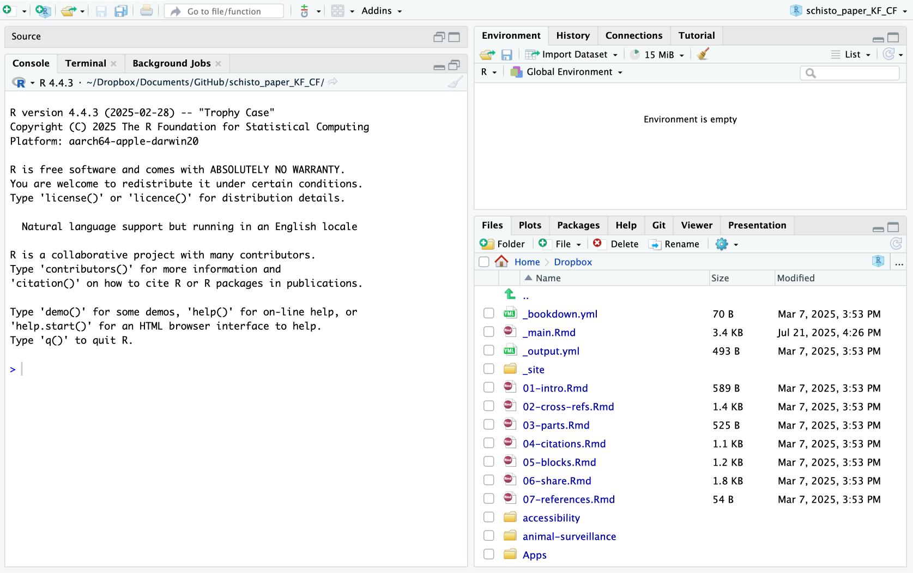
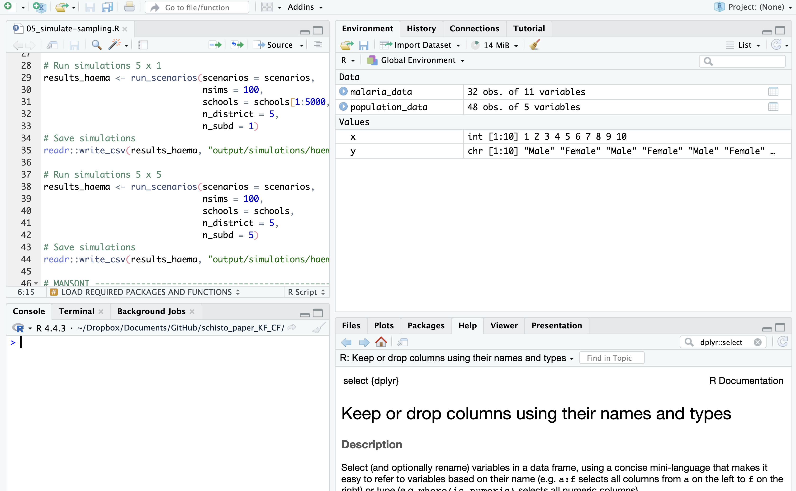

## Today's Session

:::: {.columns}
::: {.column width="50%"}
**Getting data in & oriented**

- Reading data — `read_csv()`, `read_excel()` <br><span class="muted small">flat files and spreadsheets</span>
- Inspecting — `glimpse()`, `summary()` <br><span class="muted small">know your data before you touch it</span>
- The pipe `|>` <br><span class="muted small">chain steps into readable sentences</span>
- Rows — `filter()`, `arrange()` <br><span class="muted small">ask questions of your data</span>
:::
::: {.column width="50%"}
**Shaping & summarising**

- Columns — `select()`, `rename()` <br><span class="muted small">keep only what matters</span>
- Deriving variables — `mutate()`, `case_when()` <br><span class="muted small">create meaning from raw values</span>
- Aggregation — `group_by()` + `summarise()` <br><span class="muted small">collapse many rows into insight</span>
- Joining tables <br><span class="muted small">unite data from multiple sources</span>

**Visualising**

- `ggplot2` — grammar of graphics <br><span class="muted small">bar charts, column charts, maps</span>
:::
::::

# Getting Started with R

## Roadmap

:::: {.columns}
::: {.column width="50%"}
**Orientation**

- What R is, and R vs RStudio 
- Navigating RStudio & using Projects 
- Objects, comments, and data types 
:::
::: {.column width="50%"}
**Building blocks**

- Objects vs vectors 
- Vectors · matrices · lists · data frames 
- A hands-on practice slide, then the tidyverse 
:::
::::

## What is R?

- R is a programming language for **statistical computing** built specifically for data analysis, statistical modelling, and visualisation.
- It is **free and open source** anyone can use it, inspect it, and extend it.
- Created by **Ross Ihaka** and **Robert Gentleman** at the University of Auckland in the early 1990s; the first public release came in **1995**.
- Since **1997**, the **R Core Team** has maintained the source code.

> Think of R as the **engine** that does the actual computation.

## A Short History

- R quickly gained traction among statisticians, researchers, and data analysts thanks to its **flexibility**.
- Its real growth came from a **vibrant community** of developers contributing packages and extensions — the ecosystem, not the core, is where most of R's power lives.
- Today it is firmly established across both **academia and industry**.

> The story of R is really the story of its community. Every analysis you'll run this week leans on code that someone, somewhere, contributed for free. <span class="muted small">(Huang & Yang, 2022)</span>

## R vs RStudio

:::: {.columns}
::: {.column width="50%"}
**R** — the programming language

- Does the actual computation
- Runs your code, returns results
- Can work on its own
:::
::: {.column width="50%"}
**RStudio (now Posit)** — the IDE

- An *Integrated Development Environment* for R
- Makes writing R easier and more efficient
- Editor, console, plots, help, and environment in one window
:::
::::

> RStudio sends your code to R, and R sends the results back.

## Installing R & RStudio

Two installs, in this order:

1. **R — the language** — from [cloud.r-project.org](https://cloud.r-project.org/)
2. **RStudio / Posit — the IDE** — from [posit.co/download/rstudio-desktop](https://posit.co/download/rstudio-desktop/)

> Install **R first**, then RStudio — RStudio looks for an R engine already on your machine.

. . .

> For *this* session you don't need either: every code cell on these slides runs real R **live in your browser** via WebR. Click into a cell, edit it, and press **Run**. For your own projects, though, install both.

## Navigating RStudio

RStudio organises everything into **four panes**.

:::: {.columns}
::: {.column width="58%"}
{fig-align="center" width="100%"}
:::
::: {.column width="42%"}
- **Source editor** *(top-left)* — write and save your `.R` scripts
- **Console** *(bottom-left)* — where code runs and results print
- **Environment** *(top-right)* — the objects in your current session
- **Files · Plots · Packages · Help** *(bottom-right)* — files, charts, packages, docs
:::
::::

> The **Environment** pane is your live inventory. Every object you create appears there with its type and size.

## RStudio in Action — Run & See

The core loop: type a command in the **Console**, press Enter, and the result appears — as text, or as a chart in the **Plots** pane.

:::: {.columns}
::: {.column width="50%"}
{width="100%"}
:::
::: {.column width="50%"}
{width="100%"}
:::
::::

> Code typed in the Console runs at once but isn't saved. Code written in the **Source editor** *is* saved and re-runnable — which is why real work lives in scripts, not the Console.

## RStudio in Action

As you create objects they fill the **Environment**; when you need a function's arguments, the **Help** pane holds the official documentation.

:::: {.columns}
::: {.column width="50%"}
{width="100%"}
:::
::: {.column width="50%"}
{width="100%"}
:::
::::

> Reach Help instantly from the Console: `?mean` opens the docs for any function. The **Files** tab (bottom-right) is your project's folder, right inside the IDE.

## Organising Your Work with Projects

- An **R Project** is a dedicated folder that keeps all the files, scripts, and data for a single analysis **in one place**.
- It keeps your work organised and makes your code **reproducible and easier to share**.
- Projects manage file paths **automatically** — so you never have to call `setwd()` or hard-code a path again.

. . .

> Create one with **File → New Project**. Inside a project, paths are *relative* to the project root — `read_csv("data/ideal3a.csv")` works on your machine, your colleague's, and the marker's, with no edits. This single habit prevents most "it works on my computer" problems.

## Objects & Assignment

- R stores data in **objects** — labelled containers you can reuse.
- Assign a value to an object with the arrow `<-` (or `=`, though `<-` is the convention).
- Type an object's name to print it back.

```{webr-r}
#| label: intro-objects
# store values in objects
x <- 42
my_name <- "your_name"

# call the objects back
x
my_name
```

> Keyboard shortcut for `<-` in RStudio: **Alt + -** (minus). You'll type it hundreds of times a day.

## Things to Note

- R is **case-sensitive** — `Weight` and `weight` are two different objects.
- R is **object-oriented** — almost everything you work with is an object.
- Object names may use letters, numbers, `.` and `_`, but **cannot** start with a number, use a reserved word (`TRUE`, `FALSE`, …), or contain special characters (`#`, `\`, `/`, `*`, `&`).
- The `#` sign starts a **comment** — R ignores everything after it on that line.
- Core data types: **numeric**, **character**, **logical**, **factor**, and **dates**.

```{webr-r}
#| label: intro-casing
# case-sensitivity in action
Weight <- 30
weight <- 25

Weight == weight   # FALSE — these are two different objects
```

## Data Types in R

- Every value in R has a **type**. Knowing the type tells you what you can do with it.
- Use `class()` to ask R what kind of thing an object is.

```{webr-r}
#| label: intro-types
# inspect the types of three columns from the IDEAL dataset
# numeric — a measurement
class(ideal$Weight)    
# character — a text label
class(ideal$ReasonsLoss1)  
class(ideal$CalfSex)
```

> Notice `CalfSex` is stored as an integer code, not a label. Spotting that here is exactly why we'll reach for `mutate()` and `case_when()` later to turn codes into meaning.

## Objects vs Vectors

A common point of confusion. The two words describe different things:

- An **object** is the general term for *anything* you name and store — a single value, a table, a model, a plot. Everything in R is an object.
- A **vector** is one specific *structure* an object can take: an ordered collection of elements that are **all the same type**.
- There is no such thing as a lone "single value" in R — `x <- 42` is really a **vector of length 1**.

```{webr-r}
#| label: intro-obj-vs-vec
x <- 42 # an object holding one value...
nums <- c(10, 20, 30)   # ...and an object holding a vector

length(x)  # 1  — a length-1 vector
length(nums) # 3
is.vector(x) # TRUE — even one value is a vector
```

> The takeaway: **object** is the noun for anything stored in R; **vector** is the simplest shape that object can take. The four structures coming next — vectors, matrices, lists, and data frames — are all *kinds of objects*.

## Vectors in R

Vectors are the most basic data structure — a collection of elements of the **same type**. Build one with `c()` ("combine"), and reach into it with `[index]`.

```{webr-r}
#| label: intro-vectors
# Different vector types
nums <- c(10, 20, 30)
chars <- c("apple", "banana", "cherry")
logicals <- c(TRUE, FALSE, TRUE)

# Vector operations
nums * 2 # multiply every element by 2
nums[2] # get the second element
length(nums) # how many elements?
```

> Operations apply to the **whole vector at once** — `nums * 2` doubles all three values without a loop. This is *vectorisation*, and it's why R code for data is so compact.

## Matrices in R

Matrices are **two-dimensional** arrays where every element must be the **same type**. Build one with `matrix()`, giving it data plus dimensions (`nrow`, `ncol`); index it with `[row, column]`.

```{webr-r}
#| label: intro-matrices
# Create a matrix from the numbers 1 to 12, arranged in 3 rows
mat <- matrix(1:12, nrow = 3, ncol = 4)
mat

# Dimensions
dim(mat) # rows and columns

# Access elements
mat[2, 3] # row 2, column 3
mat[1, ]  # the entire first row
mat[, 2]  # the entire second column
```

> Leaving an index blank means "all of it": `mat[1, ]` is the whole first row, `mat[, 2]` the whole second column. You'll use this exact `[row, col]` logic on data frames next.

## Lists in R

Unlike a vector, a **list** can hold a **mix** of types and structures — numbers, text, vectors, even other lists.

- **Mixed types** — numbers, text, vectors, all in one container
- **Named elements** — reach them with `$`
- **Flexible length** — elements can be different sizes
- **Nested** — lists can contain lists

```{webr-r}
#| label: intro-lists
# a list mixing a string, a number, and a vector
person <- list(
  name = "Amina",
  age = 32,
  scores = c(80, 92, 75)
)

person$name  # access by name with $
person[["scores"]] # access by name, bracket form
person[[2]] # access by position
```

> Lists are R's flexible workhorse — model outputs, nested API responses, and the data frames you're about to meet are all built on top of them.

## Data Frames in R

A **data frame** is like a spreadsheet — the most common structure for real analysis. Columns can be **different types**, but every column has the **same number of rows**.

```{webr-r}
#| label: intro-dataframes
# columns of equal length; types may differ
df <- data.frame(
  county = c("Turkana", "Nairobi", "Kisumu"),
  cases  = c(120, 85, 60)
)
df

df$county # one column, by name
df[1, ] # one row, by position
df[, "cases"] # one column, by name and position
```

> A **tibble** — what `read_csv()` returns — is just a modern data frame with friendlier printing. The `ideal` dataset you'll wrangle next *is* a tibble: rows of calf visits, columns of measurements.

## Your Turn — Practice Exercise

Time to put it together. Create each structure yourself, then explore it with `str()`, `class()`, `length()`, and `dim()`. Edit the cell and press **Run**.

```{webr-r}
#| label: intro-practice
# Practice area — experiment, then press Run

# 1. Create your own vector


# 2. Make a matrix


# 3. Build a list


# 4. Construct a data frame


# Explore with: str(), class(), length(), dim()
```

> No wrong answers here — break things on purpose. Try mixing types inside `c()` and watch what R does (it quietly coerces them to one type). Curiosity now saves debugging later.

## The R Ecosystem

R ships with a core, and the community builds outward from there. Packages fall into three tiers:

| Tier | Who builds it | How you get it |
|------|---------------|----------------|
| **Base packages** | The R Core Team | Installed by default with R |
| **Recommended packages** | Community, curated by R Core | Also shipped by default |
| **Contributed packages** | Anyone | Installed by *you* — from **CRAN** or sometimes **GitHub** |

> As of a March 2024 count, CRAN alone hosted over **20,500** packages — and that number climbs every week. You will only ever need a small, dependable handful.

## Recent Developments

- The ecosystem keeps evolving — with active growth in **deep learning**, modern **data analysis**, and **visualisation**.
- R integrates cleanly with other tools you may already use: **Python, SQL, CSS, HTML and JavaScript**.

. . .

| Tool | What it's for |
|------|---------------|
| **RStudio / Posit** | Integrated development environment for R *and* Python |
| **tidyverse** | A coherent toolkit for data science |
| **ggplot2** | Data visualisation — the grammar of graphics |

> `tidyverse` and `ggplot2` are the two you'll use most this week — they're the backbone of the Data Wrangling section that follows.

## What We'll Cover This Week

- **Basics of the program** — installing packages, the workspace, working directories
- **Importing data** into R
- **Data wrangling / cleaning** — reshaping messy data into tidy data
- **Data visualisation** — turning tables into charts and maps

> Today's focus is the middle of that list — *importing, wrangling, and visualising*. The very next section picks up exactly there.

